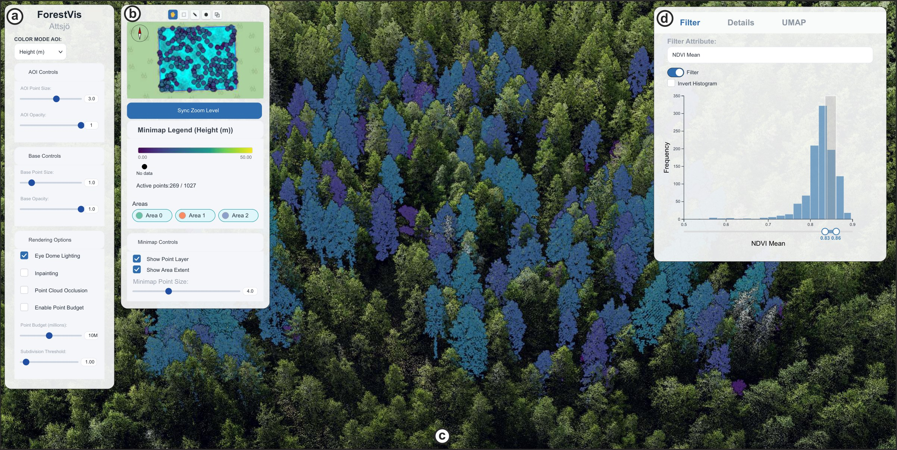

# ForestVis

ForestVis is a web-based visualization system for tree-level forestry analysis.
It incorporates an interconnected forest overview, with interactive filtering,
and detail selection from linked views: a 2D minimap, attribute histograms and
a UMAP projection of per-tree statistics, all tied to a 3D LiDAR point cloud.

*The ForestVis interface on the Attsjö dataset, from the paper's teaser figure.
(a) Rendering controls, (b) minimap and legend, (c) point cloud view comparing
tree height and NDVI using a filtered height layer, (d) filtering by mean NDVI.*

## Features

- **3D point cloud view**: streams COPC point clouds in the browser, coloured by
  height, NDVI or other vegetation indices, with eye-dome lighting, inpainting
  and a point budget.
- **Linked minimap**: a 2D overview of the study areas with box, lasso, polygon
  and combined selection tools that select trees in every view.
- **Attribute filtering**: histograms with range sliders and KDE curves to
  filter trees by attribute and compare areas.
- **Tree details**: click a tree in the point cloud to see histograms of its
  NDVI and RGB values.
- **UMAP projection**: an in-browser UMAP of per-tree statistics, with brush
  selection linked back to the map and point cloud.
- **SVG export**: the current view as a figure or on-screen layout.

## Demo

**Live demo: <https://benpowley.github.io/ForestVis-Demo/>**

The demo runs entirely in the browser as a static site; no server or install is
needed. A recent desktop browser with WebGL 2 is recommended.

## Demo data

The demo uses NEON data from Lower Teakettle (TEAK), Sierra Nevada, California:
a 300 × 300 m area around the NEON tower, split into three 100 m wide areas,
with 3 × 3 km of surrounding forest as context. Flown July 2023.

- 1.96 million points in the main area, with 3456 trees segmented using
  SegmentAnyTree (Wielgosz et al. 2024)
- Per-point and per-tree NDVI, GNDVI, LCI, NDRE and OSAVI from the NEON
  reflectance mosaic, plus tree height
- 10 cm RGB orthophoto and 1 m NDVI raster

The prepared data is in a separate repository,
[ForestVis-demo-data](https://github.com/BenPowley/ForestVis-demo-data), which
describes the files and processing. The pipeline scripts are in
[`pipeline/teak/`](pipeline/teak/).

Data from the National Ecological Observatory Network (NEON), operated by
Battelle and sponsored by the National Science Foundation:

- Discrete return LiDAR point cloud (DP1.30003.001), RELEASE-2026,
  <https://doi.org/10.48443/5ts2-rc92>
- High-resolution orthorectified camera imagery mosaic (DP3.30010.001),
  RELEASE-2026, <https://doi.org/10.48443/8vq2-s021>
- Spectrometer orthorectified surface bidirectional reflectance mosaic
  (DP3.30006.002), provisional

The derived demo data is released under
[CC BY 4.0](https://creativecommons.org/licenses/by/4.0/).

## Paper

**ForestVis: Visualization of 3D Forestry Point Clouds** 
Benjamin Powley, Petra Horváth, Basam Dahy, Nivan Ferreira, Johan E. S. Fransson,
Andreas Kerren, Claudio D. G. Linhares and Amilcar Soares 
IEEE VIS 2026

## AI assistance

Parts of this code were written with the help of AI coding assistants, using
OpenAI GPT and Anthropic Claude models.
